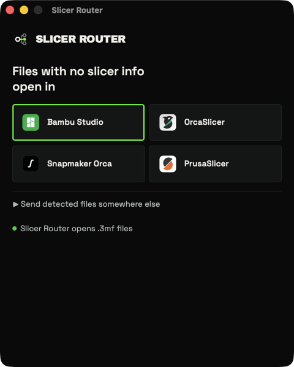
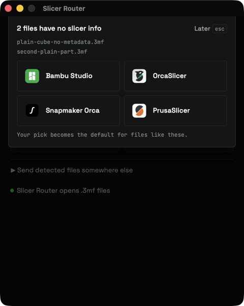
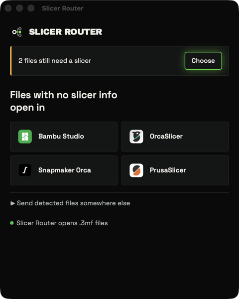

# Slicer Router

Double-click a `.3mf` and it opens in the slicer that made it. Snapmaker
projects open in Snapmaker Orca, Bambu projects in Bambu Studio, Prusa projects
in PrusaSlicer, and OrcaSlicer projects in OrcaSlicer.

The project has three parts:

| Part | What it is |
| --- | --- |
| `crates/slicer-router-core` | Rust library: read a `.3mf`, decide which slicer owns it, find installed slicers, launch one. No GUI dependencies. |
| `crates/slicer-router-cli` | The `slicer-router` command. |
| `crates/slicer-router-ffi` | A static library with a C interface, linked into the macOS thumbnail extension. One of two crates that allow unsafe code. |
| `crates/slicer-router-macos` | LaunchServices calls that read and set the default app for `.3mf`. The other crate that allows unsafe code; it compiles on every platform and finds nothing off macOS. |
| `app/` | A small Tauri 2 app, "Slicer Router", that registers as the `.3mf` file handler on macOS and Windows. On macOS it carries a Finder thumbnail extension, in `app/macos/ThumbnailExtension`. |

## How a file is routed

Detection reads three small entries from the `.3mf` zip and never loads the
model geometry, so a 100 MB file costs the same as a small one:

- `3D/3dmodel.model`, only the `<metadata name="Application">` tag at the top.
- `Metadata/project_settings.config` (Bambu Studio, OrcaSlicer, Snapmaker Orca), only the printer fields.
- `Metadata/Slic3r_PE.config` (PrusaSlicer), only the printer fields.

Rules run in this order and the first one that names a slicer wins. The
printer a project was prepared for outranks the program that saved it. Within
the printer rule, the printer model is checked first, then the preset name, then
the vendor, so a preset called `MK4S for Bambu filament` still goes to
PrusaSlicer. Within one field, slicers are tried in the order Bambu Studio,
Snapmaker Orca, PrusaSlicer.

| # | Rule name in `--json` | Fires when | Slicer |
| --- | --- | --- | --- |
| 1a | `printer-profile` | Printer model contains `Bambu`, `Snapmaker` or `Prusa`, or is exactly `MK3`, `MK3S`, `MK3.5`, `MK4`, `MK4S`, `MINI`, `XL`, `CORE One` or another Prusa model name | Bambu Studio, Snapmaker Orca or PrusaSlicer |
| 1b | `printer-profile` | No model matched, and the preset name (`printer_settings_id`) contains `Bambu`, `Snapmaker` or `Prusa` | Bambu Studio, Snapmaker Orca or PrusaSlicer |
| 1c | `printer-profile` | Neither matched, and the vendor contains `Bambu`, `Snapmaker` or `Prusa`. PrusaSlicer's `PRINTER_VENDOR_PRUSA3D` marker counts as the vendor | Bambu Studio, Snapmaker Orca or PrusaSlicer |
| 2 | `application-name` | `Application` is `BambuStudio-` followed by four numeric parts (for example `02.08.02.61` or `02.10.00.100`) | Bambu Studio |
| 2 | `application-bambu-fork` | `Application` is `BambuStudio-` followed by anything else (for example `BambuStudio-2.3.1`) | OrcaSlicer |
| 2 | `application-name` | `Application` starts with `OrcaSlicer-` | OrcaSlicer |
| 2 | `application-name` | `Application` starts with `Snapmaker_Orca-` | Snapmaker Orca |
| 2 | `application-name` | `Application` starts with `PrusaSlicer-` | PrusaSlicer |
| 3 | `prusa-config-file` | The archive has `Slic3r_PE.config` and nothing above matched | PrusaSlicer |
| - | `no-signal` | Nothing matched, for example a plain Printables or Thingiverse download | none, so your default slicer opens it |

Why the `BambuStudio-` tag needs two rows: OrcaSlicer 2.3.1 and Snapmaker Orca
up to 2.3.1 write `BambuStudio-<their own version>` as the application so that
Bambu Studio accepts their files. Their versions have three parts. Bambu
Studio's own releases have four. Snapmaker Orca 2.4.0 writes `Snapmaker_Orca-`
instead.

A project with no matching printer and an `OrcaSlicer-` tag opens in OrcaSlicer.
A Bambu Lab P1S project saved by OrcaSlicer opens in Bambu Studio, because the
printer profile wins.

### Choosing the installed slicer

After detection, routing is a pure function of the verdict, the installed
slicers and your config:

1. The config override for the detected slicer, if that slicer is installed.
2. The detected slicer, if installed.
3. The configured default, if installed.
4. If none of those apply, a lone installed slicer is used. With none, the
   router reports that no slicer is installed. With several, it asks:
   - For a file with no signal, the answer becomes your default slicer.
   - For a file that belongs to a slicer you have not installed, the question
     says so ("Snapmaker Orca isn't installed"), and the answer is saved as an
     override for that slicer. Other files keep their own routing.

The settings window asks these questions and edits the same config. See
[The settings window](#the-settings-window).

### Config

A JSON file, created when you pick a default:

| OS | Location |
| --- | --- |
| macOS | `~/Library/Application Support/Slicer Router/config.json` |
| Windows | `%APPDATA%\Slicer Router\config.json` |
| Other | `$XDG_CONFIG_HOME/slicer-router/config.json` |

Set `SLICER_ROUTER_CONFIG` to use another path.

On macOS the app also keeps `routing-snapshot.json` beside the config file for
the Finder thumbnails. See [Finder thumbnails](#finder-thumbnails).

```json
{
  "default_slicer": "orca-slicer",
  "overrides": { "bambu-studio": "orca-slicer" }
}
```

`overrides` maps a detected slicer to the slicer that should open its files
instead. Slicer ids are `bambu-studio`, `orca-slicer`, `snapmaker-orca` and
`prusa-slicer`.

A slicer id this version does not know is skipped with a warning instead of
failing the whole file, and other top-level keys are kept when the router saves.
Only a file that is not a JSON object is rejected. Choosing a default or an
override in the app replaces such a file.

### How slicers are found

- **macOS.** Apps in `/Applications`, `~/Applications` and one folder level
  below them, matched by `CFBundleIdentifier`. PrusaSlicer's identifier ends in a
  `/` and the match ignores it. When two bundles share an identifier, the one with
  the shortest bundle name wins. Slicers are launched with `open -a <their .app>`,
  so the router never relaunches itself.
- **Windows.** The `App Paths` and `Uninstall` registry keys, then the usual
  `Program Files` folders. A path from the registry must be an `.exe` or a
  folder holding one, and `%VARIABLES%` in registry values are expanded. Slicers
  are started by running their executable with the file as the argument.

The file path is made absolute before launch. On macOS the router waits for
`open` to hand the file over, so a broken app bundle is reported as an error. On
Windows it returns as soon as the slicer process exists and does not see a later
failure inside the slicer.
- **Linux.** Not supported yet. The library compiles but finds nothing.

### How the app opens files

The app routes files before it starts any UI. Windows starts one process per
selected file, so each process detects its own file, launches the slicer and
exits. The app window and its single-instance handoff start only when a person is
needed: no file was given, a question has to be asked, or a file did not open.

macOS delivers opened files to the running app as an open-documents event, so the
app has to start first. That event arrives before the launch finishes (about
140 ms earlier on macOS 26), so when the app is ready it already knows whether
files came. It shows the settings window only for a direct launch, with no timer
and no window to take back.

## The settings window

Launching Slicer Router directly, or reopening it, shows a 480 by 600 window.
It never shows more than one sheet at a time.

<p>
  
  
  
</p>

- **Default slicer.** One tile per installed slicer, each with the icon read from
  its own app (macOS reads `CFBundleIconFile` and converts it with `sips`; other
  platforms and apps without a readable icon show a lettered tile). The selected
  tile is the slicer for files with no slicer info.
- **Overrides.** "Send detected files somewhere else" has a menu per kind of
  project (Bambu, Snapmaker, Prusa, OrcaSlicer). Choosing the detected slicer
  itself removes the override. When that slicer is not installed, the empty
  choice says what routing does instead: the default slicer, the only installed
  slicer, or ask.
- **Questions.** Files that wait for a choice (see
  [Choosing the installed slicer](#choosing-the-installed-slicer)) drop a sheet
  from the top of the window, one group at a time. Esc, a click outside it, or
  Later closes it and leaves that group waiting, with a Choose button to bring it
  back. A group that arrives afterwards opens its own sheet. Waiting files live
  in memory, so they are forgotten when the app quits.
- **Failures.** A file that did not open (no slicer installed, a version of
  Slicer Router that cannot route it, or a launch that failed) gets a red sheet
  that lists up to three file names with a reason. It offers the installed
  slicers that did not fail to open every failed file once, without changing the
  config, and "Try again" for the slicers that still exist. A slicer whose app
  was moved or deleted, or a file that was, cannot be retried. Each button acts
  only on the files the sheet listed. Failures stay until dismissed, and the app
  quits once the last one is, unless you opened the window yourself.
- **Default app.** The window says whether Slicer Router opens `.3mf` files and,
  when it does not, which app does. See
  [Make Slicer Router the default .3mf app](#make-slicer-router-the-default-3mf-app).
  When the platform cannot say, it shows nothing.

## Finder thumbnails

On macOS, Finder shows each `.3mf` with the slicer it will open in. The
thumbnail is the plate preview the file carries, or a plain card with the file's
name when it has none. The icon of the slicer that will open the file sits in the
bottom-right corner. The router chooses that slicer exactly as it does when the
file is opened: an override, the detected slicer, your default slicer, or the
only slicer installed. When it would ask which slicer to use, or no slicer is
installed, the corner shows Slicer Router's own icon.

The preview is `Metadata/plate_1.png` (Bambu Studio, OrcaSlicer, Snapmaker Orca),
then `Metadata/thumbnail.png` (PrusaSlicer), then whatever image the package
names in `_rels/.rels`. MakerWorld downloads name a 240 by 180 cover there, so the
512 by 512 plate render is preferred. Images over 4 MiB, or with more pixels than
4096 by 4096, are skipped.

How it fits together:

- `Slicer Router.app/Contents/PlugIns/SlicerRouterThumbnail.appex` is a Quick Look
  thumbnail extension written in Swift. It runs in a sandbox, so it can neither
  look for installed slicers nor read the config.
- Each time the app runs, which is every time a `.3mf` is opened, and after you
  choose a slicer in its window, it writes `routing-snapshot.json` beside
  `config.json`: the installed slicers, the default slicer and the overrides. The
  extension may read that one folder and routes each file with the same code.
- When the snapshot changes, the app resets the Quick Look thumbnail cache
  (`qlmanage -r cache`). Quick Look keeps a thumbnail until the file itself
  changes, so without the reset Finder would keep the old badges.
- The CLI does not write the snapshot. A default set with `slicer-router default`
  shows in Finder after the app next runs.
- The slicers claim `.3mf` by file extension and declare no file type, and a
  Quick Look extension can only target a declared type. The app declares
  `com.shapr3d.3d-manufacturing.3mf` exactly as Shapr3D does, so `.3mf` has the
  same type whether Shapr3D is installed or not.

To see a thumbnail without Finder:

```sh
qlmanage -r cache
qlmanage -x -t -s 512 -o /tmp model.3mf   # writes /tmp/model.3mf.png
```

`-x` matters. Without it, `qlmanage -t` hung on these thumbnails on macOS 26.5.

## Install

There are no prebuilt releases yet. Build from source. The core and CLI crates
need Rust 1.88 or newer. The app needs 1.90 or newer, because Tauri 2 does.

```sh
# CLI
cargo install --path crates/slicer-router-cli

# App (needs the Tauri CLI once: cargo install tauri-cli --version "^2" --locked)
scripts/build-macos.sh --no-sign   # macOS, with the thumbnail extension, ad hoc signed
cd app/src-tauri && cargo tauri build --bundles nsis   # Windows
```

The output lands in the workspace's `target` folder at the repository root, not
under `app/src-tauri`: `target/aarch64-apple-darwin/release/bundle/macos/Slicer Router.app`
and `SlicerRouter-<version>-arm64.zip` beside it on macOS, and
`target/release/bundle/nsis/*.exe` on Windows. The macOS build is for Apple
silicon only.

On macOS copy `Slicer Router.app` to `/Applications` and open it once, so it
records the installed slicers for the thumbnails. An ad hoc signed build may need
right-click, Open the first time. Thumbnails have been verified only with a
Developer ID signed build (below).

The app icon comes from `app/icon/generate.py`, which writes the two SVG masters
and every PNG, `.icns` and `.ico` under `app/src-tauri/icons`. Edit the script,
not the generated files. It needs `rsvg-convert` (`brew install librsvg`).

`cargo tauri build --bundles app` alone still builds the app, without the
thumbnail extension.

The crates are not published to crates.io (`publish = false`). Depend on the core
crate as a git dependency, pinned to a release tag:

```toml
slicer-router-core = { git = "https://github.com/PrintHive/slicer-router", tag = "<release tag>" }
```

### Signed and notarized macOS builds

```sh
export APPLE_SIGNING_IDENTITY="Developer ID Application: Your Name (TEAMID)"
scripts/build-macos.sh --notarize --out dist
```

The script builds `slicer-router-ffi` as a static library and the app with Tauri,
compiles the extension with `swiftc` (no Xcode project), and puts it in
`Contents/PlugIns`. It signs the extension with its sandbox entitlements
(`app/macos/ThumbnailExtension/SlicerRouterThumbnail.entitlements`) and then the
app, both with the hardened runtime and without `--deep`, which would re-sign
the extension without its sandbox. `--notarize` submits the zip with the
`notarytool` keychain profile named by `NOTARY_PROFILE` (default
`slicer-router`), waits, and staples the ticket. Create the profile once with
`xcrun notarytool store-credentials slicer-router`.

## Make Slicer Router the default .3mf app

**macOS.** Open Slicer Router and click "Make Slicer Router the default". It
sets the default app for `.3mf` through LaunchServices and checks that it took.
By hand: in Finder select any `.3mf`, press `Cmd+I`, choose Slicer Router under
Open with, then click Change All. The app has to be in `/Applications` and opened
once before macOS knows it.

**Windows.** An app cannot set the default itself. Open Slicer Router and click
"Reveal a .3mf in Explorer". It selects a small example `.3mf` in the temp folder.
Right-click it, choose Open with, Choose another app, pick Slicer Router, then
Always. Or: Settings, Apps, Default apps, search for `.3mf`, choose Slicer Router.
The window reads the choice from `HKCU\Software\Microsoft\Windows\CurrentVersion\Explorer\FileExts\.3mf\UserChoiceLatest`,
falling back to `UserChoice`. Picking Slicer Router from the Open with list
records `Applications\slicer-router-app.exe` instead of the installer's file class,
and the window counts that as Slicer Router too.

Then turn off "Associate .3mf files" in the preferences of Bambu Studio,
OrcaSlicer, Snapmaker Orca and PrusaSlicer (the label varies a little). Each of
them rewrites `HKCU\Software\Classes\.3mf` to itself every time it starts while
that option is on, and takes the association back from Slicer Router. Snapmaker
Orca does this in `GUI_App.cpp` at startup when `associate_3mf` is true.

The installer registers a project-owned file class, `PrintHive.SlicerRouter.3mf`,
instead of a generic "3MF Project" class, and lists it under the `.3mf`
`OpenWithProgids` key. Slicer Router therefore stays in the Default apps list even
after a slicer has taken the `.3mf` default. This lives in
`app/src-tauri/tauri.windows.conf.json` and `app/src-tauri/windows/hooks.nsh`, so
the macOS bundle is unchanged.

Launch Slicer Router directly to see the installed slicers, pick the slicer for
files with no origin, and see whether it is the default app.

## Developing the window

The window is plain HTML, CSS and JavaScript in `app/ui`, with no build step.
To work on it without building the app, serve `app` and open
`/ui-preview/index.html`. It loads the shipped markup, styles and script in a
480 by 600 frame against fixture states (files waiting, failures, not the
default app and others) that `app/ui-preview/fake-tauri.js` stands in for. The
preview is outside `frontendDist`, so it is never bundled.

```sh
python3 -m http.server 8000 --directory app   # then open http://127.0.0.1:8000/ui-preview/index.html
```

## CLI

```sh
slicer-router detect model.3mf          # verdict and evidence
slicer-router detect model.3mf --json   # same, as JSON
slicer-router open model.3mf            # route and launch
slicer-router open model.3mf --dry-run  # show the choice, launch nothing
slicer-router slicers                   # installed slicers
slicer-router default orca-slicer       # set the default; omit the id to show it
```

Example:

```text
$ slicer-router detect snapmaker-u1.3mf
slicer:        snapmaker-orca (Snapmaker Orca)
rule:          printer-profile
application:   BambuStudio-2.2.4
printer model: Snapmaker U1
```

## Library

```rust
use slicer_router_core::{detect, discover_installed, launch, route, Config, Route};

let verdict = detect("model.3mf".as_ref())?;
let installed = discover_installed();
let slicers: Vec<_> = installed.iter().map(|i| i.slicer).collect();
if let Route::Launch { slicer, .. } = route(&verdict, &slicers, &Config::default()) {
    let target = installed.iter().find(|i| i.slicer == slicer).unwrap();
    launch(target, "model.3mf".as_ref())?;
}
```

`detect` fails only when the file is not a readable zip. `classify` applies the
rules to evidence you already read. `Verdict::no_signal()` is what the app uses
for an unreadable file, so the chosen slicer shows its own error.

## Status

Verified on macOS: detection against real slicer output, discovery of the four
slicers, the app opening files in the right slicer end to end, and thumbnails
rendered through Quick Look for real Bambu Studio, Snapmaker Orca, OrcaSlicer and
PrusaSlicer files.

Not yet run on Windows. The core crate type-checks and passes clippy for
`x86_64-pc-windows-msvc`, and the CI workflow runs the tests there, but registry
discovery, the Tauri app, the NSIS file association, the default-app status read
from `UserChoiceLatest` and `UserChoice`, and the Explorer reveal have not been exercised on a Windows
machine.

## License

MIT. See [LICENSE](LICENSE).
